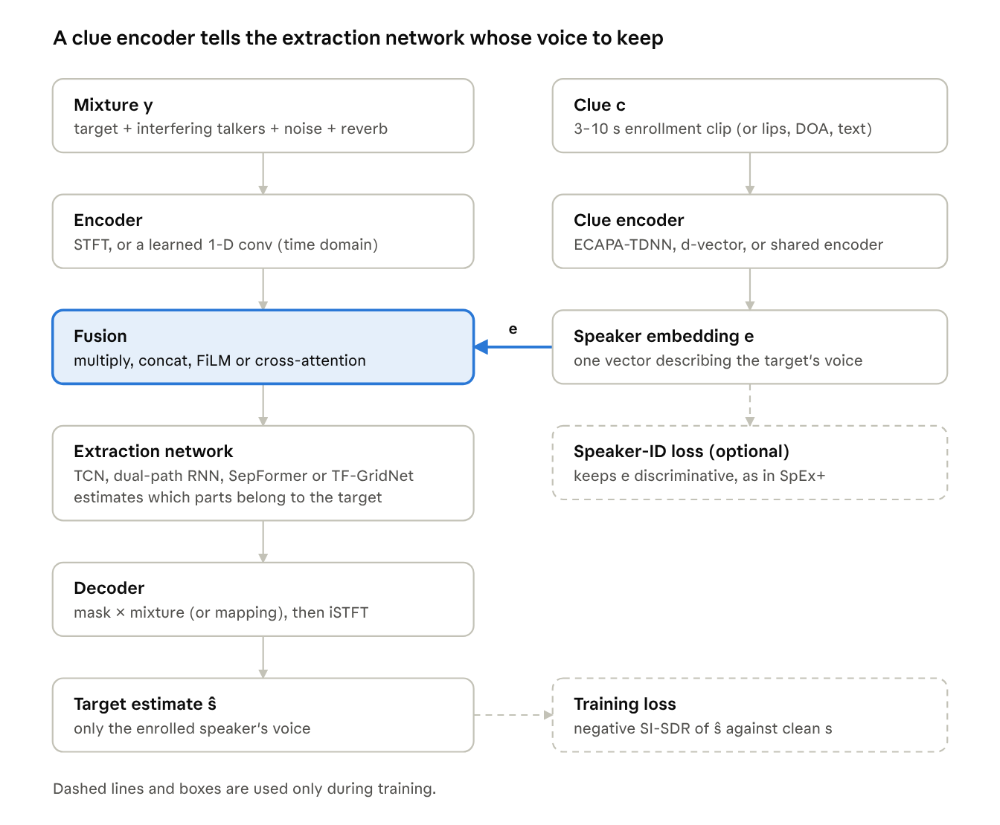
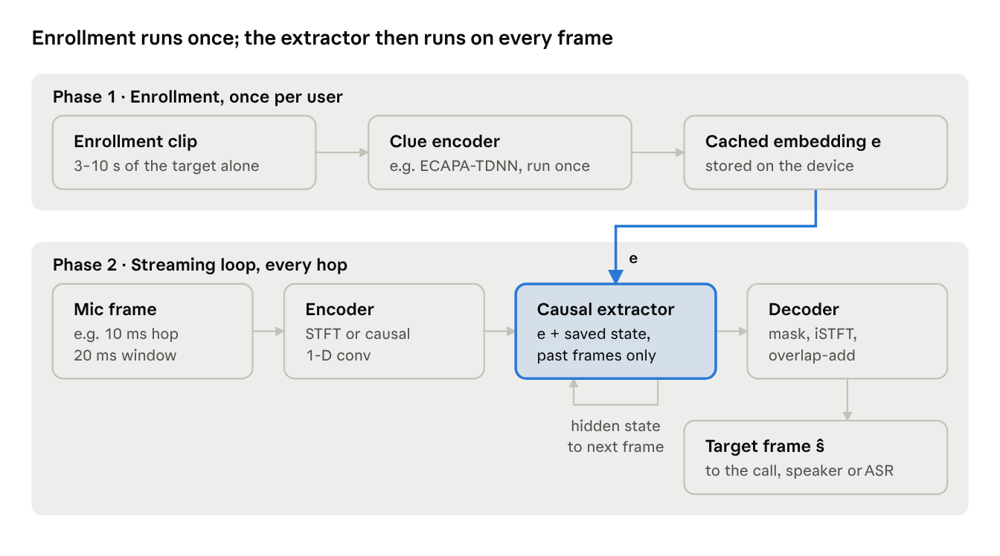

# Target Speech Enhancement — Literature Survey

*As of 25 Nov 2026*

## 1. Problem definition

Target Speech Enhancement (TSE) recovers the speech of **one chosen speaker** from a recording that also holds other talkers, noise and reverberation, using a **clue** that tells the system who that speaker is. In the literature the same task is also called *target speech extraction*, *target speaker extraction*, *speaker-conditioned separation* or *personalized speech enhancement (PSE)*. The 2023 IEEE Signal Processing Magazine overview by Zmolikova et al. is the standard reference for the field.

**Signal model.** The microphone signal y is the target speech s plus interfering speakers, noise and reverberation:

$$
y(t) = s_{\text{tgt}}(t) * h_{\text{tgt}}(t) + \sum_{i=1}^{I} s_i(t) * h_i(t) + n(t)
$$

The TSE network f, with parameters θ, takes the mixture and a clue c about the target and estimates the target:

$$
\hat{s}_{\text{tgt}} = f_{\theta}\big(y,\ c\big), \quad c \in \{\text{enrollment audio},\ \text{lip video},\ \text{direction},\ \text{text}, \dots\}
$$

**How it differs from related tasks.**

| Task | Output | Needs to know the number of speakers? | Speaker-order (permutation) problem? | Keeps a competing talker? |
| --- | --- | --- | --- | --- |
| Speech enhancement (SE) | All speech, noise removed | No | No | Yes — it cannot tell voices apart |
| Blind speech separation (BSS) | One stream per speaker | Usually yes | Yes — needs PIT and a later step to pick a stream | No, but you still must choose a stream |
| **Target speech enhancement / extraction (TSE)** | Only the target's speech | No | No — the clue fixes the output | No — interferers are removed |

TSE suits real products: hearing aids, video calls ("voice isolation"), smart speakers, and ASR front-ends, where only the enrolled user's voice matters. Two flavours exist: **TSE in speech mixtures** (the hard part is a competing talker) and **personalized SE** (mostly noise plus occasional background talkers, real-time and low compute).

## 2. General architecture

Nearly every TSE system has two branches: a **clue encoder** that turns the clue into a speaker representation, and an **extraction network** that processes the mixture and is conditioned on that representation at a **fusion** point.

The mixture flows down the left; the clue's embedding joins it at the fusion block, which is where most papers innovate. Fusion styles, oldest to newest: multiplicative adaptation (SpeakerBeam), concatenation (VoiceFilter, SpEx+), FiLM scale-and-shift, and cross-attention between mixture and enrollment features (USEF-TSE, X-CrossNet). Embedding-free models replace the separate clue encoder with the same encoder used for the mixture. Generative models keep the clue path but swap the mask-and-decoder for a token LM or flow model that synthesizes ŝ.

## 3. Taxonomy of clues

Audio enrollment is the dominant clue: a 3–10 s clean clip of the target is the most common setting in papers and products. The other clues are used when enrollment is unavailable or unreliable.

| Clue | What the system gets | Typical encoder | Strengths | Weaknesses | Representative work |
| --- | --- | --- | --- | --- | --- |
| **Audio enrollment** | A short clean recording of the target | d-vector / x-vector / ECAPA-TDNN, or a jointly trained auxiliary network | Works with one mic; easy to collect once | Fails when target and interferer sound alike (same gender); enrollment–mixture mismatch | VoiceFilter, SpeakerBeam, SpEx+, USEF-TSE |
| **Visual (lips / face)** | Video of the target's mouth region | 3D-CNN + ResNet lip encoder, often pretrained on lip reading | Robust to similar voices; tracks timing of speech | Needs a camera; occlusion, off-angle faces | Looking to Listen, AV-ConvTasNet, VisualVoice, AV-SepFormer |
| **Spatial (direction)** | Direction of arrival (DOA) or position | Directional features from a mic array (IPD, beamformer output) | Strong with arrays; no enrollment | Needs multiple mics; fails if speakers are co-located | Neural spatial filters, multi-channel SpeakerBeam, ReZero |
| **Text / semantic** | A description or transcript ("the woman speaking slowly") | Text encoder (BERT, CLAP, LLM) | Flexible, natural-language queries | Ambiguous descriptions; young research area | LLM-TSE, language-queried TSE |
| **Multimodal / hybrid** | Two or more of the above | Fusion of the encoders above | Falls back when one clue fails | More complex training and data | Multi-clue TSE (audio + visual + spatial) |

For a single-microphone project, **audio enrollment** is the practical choice: data is easy to simulate from LibriSpeech and the strongest public baselines use it.

## 4. Key papers and architectures

The field has moved through four generations: frequency-domain masking (2017–2019), time-domain extraction (2020–2021), transformer / TF-domain models with stronger fusion (2022–2024), and generative models over discrete tokens or flows (2024–now).

1. **Frequency-domain masking.** A speaker embedding conditions a network that predicts a mask on the STFT magnitude. SpeakerBeam introduced the *multiplicative adaptation layer*; VoiceFilter concatenated a d-vector to every frame of a CNN-LSTM. Phase is reused from the mixture, which caps quality.
2. **Time-domain extraction.** Built on Conv-TasNet: a learned 1-D conv encoder replaces the STFT, so phase is learned too. TD-SpeakerBeam, SpEx and SpEx+ belong here. SpEx+ shares one encoder between mixture and reference, so both live in the same latent space.
3. **Stronger backbones and fusion.** Dual-path transformers (SepFormer) and TF-GridNet replaced TCNs. Fusion moved from concatenation / FiLM to **cross-attention**, and some models drop the speaker encoder entirely (USEF-TSE, LExt). X-TF-GridNet reports 20.7 dB SI-SDRi on WSJ0-2mix.
4. **Generative TSE.** The target is produced, not masked: an LM predicts discrete speech tokens (TSELM, LauraTSE, GenTSE) or a flow-matching / diffusion model generates it (AD-FlowTSE). These sound cleaner and generalize better out of domain, but can hallucinate words and score lower on SI-SDR; hybrids pair a discriminative front-end with a generative back-end.

In parallel, **personalized SE** for calls (pDCCRN, Personalized PercepNet, TEA-PSE, VoiceFilter-Lite) targets real-time, low-compute devices; the ICASSP 2022 and 2023 DNS Challenges ran dedicated personalized tracks.

| Year | Model | Domain | Speaker clue → fusion | Key idea |
| --- | --- | --- | --- | --- |
| 2026 | [USEF-Laura-TSE](https://arxiv.org/abs/2601.06006) | Hybrid | Enrollment, embedding-free | Discriminative front-end feeds a decoder-only LM back-end to curb token-level errors |
| 2025 | [GenTSE](https://arxiv.org/abs/2512.20978) | Discrete tokens | Enrollment prompt | Coarse-to-fine: semantic tokens, then acoustic tokens; first use of DPO for TSE |
| 2025 | [AD-FlowTSE](https://arxiv.org/pdf/2510.16995) | Flow matching | Enrollment | Deterministic flow matching; strong generative result on Libri2Mix in a single step |
| 2025 | [LExt (Listen to Extract)](https://arxiv.org/pdf/2505.05114) | Waveform / TF | Enrollment prepended to the mixture | No speaker encoder: the enrollment is an onset prompt the network attends to |
| 2025 | [LauraTSE](https://arxiv.org/html/2504.07402v1) | Discrete tokens | Enrollment prompt | First single-task TSE with an auto-regressive decoder-only LM backbone |
| 2024 | [USEF-TSE](https://arxiv.org/abs/2409.02615) | Time or TF | Shared encoder → cross multi-head attention | Embedding-free; plugs into SepFormer or TF-GridNet; IEEE/ACM TASLP 2025 |
| 2024 | TSELM | Discrete tokens | WavLM tokens → encoder-only LM | Predicts WavLM units, a vocoder rebuilds audio |
| 2023 | X-TF-GridNet | TF (complex) | Speaker embedding → fused into TF-GridNet | Complex spectral mapping; 20.7 dB SI-SDRi on WSJ0-2mix |
| 2023 | X-SepFormer | Time | Embedding → dual-path transformer | Speaker-confusion-aware chunk losses |
| 2022 | TEA-PSE | TF (complex) | ECAPA embedding | Two-stage personalized SE; top-ranked in the ICASSP 2022 DNS personalized track |
| 2021 | pDCCRN / Personalized PercepNet | TF | d-vector | Real-time personalized noise and talker suppression |
| 2020 | [SpEx+](https://arxiv.org/abs/2005.04686) | Time | Shared multi-scale encoder + ResNet speaker net → concat | Mixture and reference in one latent space; joint speaker-ID loss |
| 2020 | SpEx | Time | Multi-scale encoder → concat | Multi-scale time-domain extraction |
| 2020 | TD-SpeakerBeam | Time | Auxiliary net → multiplicative adaptation | Conv-TasNet backbone with SpeakerBeam conditioning |
| 2020 | VoiceFilter-Lite | Features | d-vector | Streaming, on-device front-end for ASR |
| 2019 | [VoiceFilter](https://arxiv.org/abs/1810.04826) | Magnitude STFT | d-vector → concat per frame | CNN + LSTM soft mask; popularized the task |
| 2018 | [Looking to Listen](https://arxiv.org/abs/1804.03619) | Complex STFT | Face embeddings → concat | Audio-visual extraction at scale (AVSpeech) |
| 2017 | SpeakerBeam | Magnitude STFT | Auxiliary net → multiplicative adaptation layer | First neural TSE with jointly learned speaker clue |

Published numbers are hard to compare: papers use different datasets (WSJ0-2mix-extr vs Libri2Mix), clean vs noisy subsets, and SI-SDR vs SI-SDRi. Re-run baselines yourself before claiming an improvement.

## 5. Training, datasets and evaluation

Most discriminative TSE models are trained end-to-end on simulated mixtures with a negative SI-SDR loss, sometimes plus a speaker-classification loss on the clue encoder.

**Training objectives.**

- **SI-SDR loss** (main loss for time-domain models):

$$
\text{SI-SDR}(\hat{s}, s) = 10 \log_{10} \frac{\lVert \alpha s \rVert^2}{\lVert \alpha s - \hat{s} \rVert^2}, \qquad \alpha = \frac{\hat{s}^{\top} s}{\lVert s \rVert^2}
$$

- **Speaker-ID auxiliary loss** — cross-entropy on the enrollment embedding (SpEx+), so the clue stays discriminative.
- **Spectral / complex MSE and multi-resolution STFT losses** — common in TF-domain and real-time personalized SE.
- **Inactive-target handling** — when the target is silent the SI-SDR loss is undefined; use an energy or SNR-based loss for those segments.
- **Generative models** — token cross-entropy (LM-based), flow-matching or score-matching loss, sometimes preference optimization (DPO).

**Datasets.**

| Dataset | Content | Typical use |
| --- | --- | --- |
| WSJ0-2mix-extr | 2-speaker WSJ0 mixtures, 8 kHz, enrollment from another utterance | Classic benchmark (SpEx family); WSJ0 needs an LDC licence |
| Libri2Mix / Libri3Mix (LibriMix) | 2–3 speaker LibriSpeech mixtures, clean or with WHAM! noise, 8/16 kHz | Free, most common modern benchmark |
| WHAM! / WHAMR! | WSJ0-2mix + real noise (+ reverberation) | Noisy / reverberant robustness |
| DNS Challenge (ICASSP 2022/2023, personalized track) | Real noisy speech with enrollment, 16/48 kHz | Personalized SE; blind test set for real-world evaluation |
| VoxCeleb2 / LRS3 / AVSpeech | Talking-face video with audio | Audio-visual TSE |
| VoxCeleb1/2 | Thousands of speakers | Pretraining speaker encoders |

**Metrics.**

- **SI-SDR / SI-SDRi (dB)** — the main signal-level metric; SI-SDRi = improvement over the unprocessed mixture.
- **SDR / SDRi** — older BSS-eval metric.
- **PESQ** (−0.5 to 4.5) and **STOI / ESTOI** (0–1) — perceptual quality and intelligibility.
- **DNSMOS / UTMOS** — non-intrusive predicted MOS, needed for generative models and real recordings without a clean reference.
- **WER** with a fixed ASR (e.g. Whisper) — catches hallucination in generative models.
- **Speaker similarity** (cosine between embeddings of output and enrollment) and **target-confusion rate** (share of test items where the wrong speaker is extracted, e.g. SI-SDRi below 0 dB).

## 6. Training and real-time inference

Training is done offline on simulated mixtures; real-time inference runs in two phases — a one-time enrollment that caches the speaker embedding, then a frame-by-frame loop that carries the network's state from one frame to the next.

**Training pipeline** (the same for offline and real-time models):

1. Pick a target utterance, plus a *different* utterance of the same speaker as the enrollment clip.
2. Mix in 1–2 interfering speakers and noise at random levels (SIR, SNR); optionally convolve with room impulse responses for reverberation. Simulating on the fly gives fresh mixtures every epoch.
3. Crop to fixed-length segments (typically 3–6 s) and batch them.
4. Forward pass: enrollment → clue encoder → embedding e; mixture + e → extraction network → ŝ.
5. Loss: negative SI-SDR of ŝ against the clean target (plus an optional speaker-ID loss); backpropagate through both branches, or freeze a pretrained speaker encoder.
6. Optimise with Adam, halve the learning rate on validation plateau, clip gradients; keep the checkpoint with the best validation SI-SDRi.

A real-time model is trained exactly this way on whole segments. The difference is the architecture: every layer may use only past samples (plus at most a few ms of look-ahead), so the same weights can later run one frame at a time.

**Offline vs real-time (causal) models.**

| Component | Offline model | Real-time model |
| --- | --- | --- |
| Input at inference | Whole recording | One short frame at a time (e.g. 10 ms hop, 20 ms window) |
| Convolutions | Symmetric, see past and future | Causal (left-padded), optional 1–2 frames look-ahead |
| Sequence modelling | BLSTM, full self-attention | Unidirectional LSTM/GRU, or attention over past frames only |
| Normalisation | Global layer norm over the utterance | Cumulative or per-frame layer norm |
| Latency budget | Not a constraint | Window + look-ahead; the DNS Challenge real-time track allowed ≤ 40 ms, hearing aids need < 10 ms |
| Example models | SpEx+, X-TF-GridNet, USEF-TSE | pDCCRN, Personalized PercepNet, TEA-PSE, VoiceFilter-Lite, causal TD-SpeakerBeam |

**Real-time inference.**

The embedding is computed once and reused for every frame. Each new hop of audio passes through the encoder, the causal extractor and the decoder, and the extractor's hidden state is kept for the next frame, so the model never needs to see the future.

**Real-time constraints.** Each frame must be processed faster than the hop arrives — real-time factor (compute time ÷ audio duration) below 1, with headroom. End-to-end latency = algorithmic latency (window + look-ahead) + compute time per frame + audio I/O buffering.

**Deployment checklist.**

- Export the model with explicit state inputs and outputs (LSTM states, convolution buffers) to ONNX or TorchScript, so the runtime carries state between calls.
- Verify that frame-by-frame output matches the full-utterance output of the same causal model; a mismatch means a hidden non-causal layer.
- Quantise (e.g. int8) and profile on the target device; report RTF and latency alongside SI-SDRi and PESQ.
- Optionally refresh the embedding online from confidently extracted target speech, to track drift in voice or microphone.

## 7. Open challenges and research gaps

The biggest unsolved problem is **target confusion**: the model extracts the wrong speaker, which is common when the two voices are similar. Each item below is a viable project angle.

- **Target confusion with similar voices** — same-gender mixtures fail far more often; remedies include speaker-ID losses, contrastive training and confusion-aware losses (X-SepFormer).
- **Enrollment mismatch** — enrollment recorded on a different mic, room or emotional state degrades results; embedding-free fusion (USEF-TSE, LExt) partly addresses this.
- **Absent or intermittent target** — the model should output silence when the target is not talking; most benchmarks always contain the target.
- **Simulation-to-real gap** — models trained on LibriMix often fail on real recordings with reverberation and many talkers.
- **Real-time and low-compute** — hearing aids and phones need causal models with < 10–20 ms latency and few MACs; most top-scoring models are non-causal and heavy.
- **Hallucination in generative TSE** — LM-based models can invent or swap words; SI-SDR alone hides this, so WER must be reported.
- **Evaluation inconsistency** — different datasets, subsets and metric implementations make published numbers hard to compare.
- **Beyond audio enrollment** — text-queried and multimodal TSE remain young, with few standard benchmarks.

## 8. Recommendations for the project

Start with a time-domain, audio-enrollment model on Libri2Mix (e.g. SpEx+ or TD-SpeakerBeam with a pretrained ECAPA-TDNN encoder), then make one targeted improvement — such as cross-attention fusion or a confusion-aware loss — and measure it against that baseline.

**Toolkits and code.**

| Toolkit | What it gives you |
| --- | --- |
| [WeSep](https://arxiv.org/abs/2409.15799) (github.com/wenet-e2e/wesep) | TSE-specific recipes, on-the-fly mixture simulation, WeSpeaker pretrained speaker encoders |
| ESPnet (ESPnet-SE) | TSE recipes incl. TD-SpeakerBeam on WSJ0-2mix and Libri2Mix |
| Asteroid | LibriMix data recipe and Conv-TasNet / DPRNN backbones |
| SpeechBrain | SepFormer, ECAPA-TDNN speaker embeddings, WHAM!/LibriMix recipes |
| USEF-TSE code (github.com/ZBang/USEF-TSE) | Embedding-free SepFormer and TF-GridNet variants |

**Suggested plan.**

1. Generate Libri2Mix (train-100, 16 kHz, `min` mode) with the official scripts; pick enrollment utterances of the target from other LibriSpeech files.
2. Train a baseline (TD-SpeakerBeam or SpEx+) with negative SI-SDR loss; report SI-SDRi, PESQ, STOI on the clean and noisy test sets.
3. Measure the target-confusion rate, split by same- vs different-gender mixtures — this exposes the main weakness.
4. Add one improvement: cross-attention fusion, a speaker-ID or contrastive loss, or a TF-domain backbone.
5. Test robustness: noisy (WHAM!) mixtures, absent-target cases, and a few real recordings scored with DNSMOS.
6. Optional: make the model causal and report real-time factor to target the personalized SE use case.

**Compute guide.** A Conv-TasNet-sized model trains on Libri2Mix train-100 in a day or two on one 16–24 GB GPU; TF-GridNet and generative models need considerably more memory and time.

## 9. References

Linked entries were checked during this survey; unlinked entries are cited from memory — verify the exact venue and year before using them in a report.

**Surveys**

1. K. Zmolikova, M. Delcroix, T. Ochiai, K. Kinoshita, J. Černocký, D. Yu, "[Neural Target Speech Extraction: An overview](https://arxiv.org/abs/2301.13341)," IEEE Signal Processing Magazine, May 2023.
2. "[Multimodal Target Speaker Extraction: Towards Unified Speaker Cues Across Modalities](https://arxiv.org/pdf/2609.35613)," arXiv 2609.35613, 2026.
3. "[Advances in Speech Separation: Techniques, Challenges, and Future Trends](https://arxiv.org/pdf/2508.10830)," arXiv 2508.10830, 2025.

**Models**

4. K. Zmolikova et al., "SpeakerBeam: Speaker aware neural network for target speaker extraction," Interspeech 2017; IEEE JSTSP 2019.
5. Q. Wang et al., "[VoiceFilter: Targeted voice separation by speaker-conditioned spectrogram masking](https://arxiv.org/abs/1810.04826)," Interspeech 2019.
6. A. Ephrat et al., "[Looking to Listen at the Cocktail Party](https://arxiv.org/abs/1804.03619)," SIGGRAPH 2018.
7. M. Delcroix et al., "Improving speaker discrimination of target speech extraction with time-domain SpeakerBeam," ICASSP 2020.
8. C. Xu, W. Rao, E. S. Chng, H. Li, "SpEx: Multi-scale time domain speaker extraction network," IEEE/ACM TASLP 2020.
9. M. Ge, C. Xu, L. Wang, E. S. Chng, J. Dang, H. Li, "[SpEx+: A complete time domain speaker extraction network](https://arxiv.org/abs/2005.04686)," Interspeech 2020.
10. Q. Wang et al., "VoiceFilter-Lite," Interspeech 2020.
11. S. E. Eskimez et al., "Personalized speech enhancement: new models and comprehensive evaluation" (pDCCRN), ICASSP 2022.
12. Y. Ju et al., "TEA-PSE: Tencent-Ethereal-Audio-Lab personalized speech enhancement system for ICASSP 2022 DNS Challenge," ICASSP 2022.
13. K. Liu et al., "X-SepFormer: End-to-end speaker extraction network with explicit optimization on speaker confusion," ICASSP 2023.
14. F. Hao et al., "X-TF-GridNet" (TF-GridNet for target speaker extraction), 2023.
15. B. Zeng, M. Li, "[USEF-TSE: Universal Speaker Embedding Free Target Speaker Extraction](https://arxiv.org/abs/2409.02615)," IEEE/ACM TASLP 33, 2110–2124, 2025.
16. B. Tang et al., "TSELM: Target speaker extraction using discrete tokens and language models," 2024.
17. "[LauraTSE: Target Speaker Extraction using Auto-Regressive Decoder-Only Language Models](https://arxiv.org/html/2504.07402v1)," arXiv 2504.07402, 2025.
18. "[Listen to Extract: Onset-Prompted Target Speaker Extraction](https://arxiv.org/pdf/2505.05114)," arXiv 2505.05114, 2025.
19. "[Adaptive Deterministic Flow Matching for Target Speaker Extraction](https://arxiv.org/pdf/2510.16995)" (AD-FlowTSE), arXiv 2510.16995, 2025.
20. "[GenTSE](https://arxiv.org/abs/2512.20978)," arXiv 2512.20978, Dec 2025.
21. "[Discriminative–Generative Target Speaker Extraction with Decoder-Only Language Models](https://arxiv.org/abs/2601.06006)," arXiv 2601.06006, 2026.

**Toolkits and data**

22. S. Wang et al., "[WeSep: A Scalable and Flexible Toolkit Towards Generalizable Target Speaker Extraction](https://arxiv.org/abs/2409.15799)," Interspeech 2024.
23. J. Cosentino et al., "LibriMix: An open-source dataset for generalizable speech separation," arXiv 2005.11262, 2020.
24. "[X-CrossNet: complex spectral mapping for TSE with cross-attention speaker embedding fusion](https://arxiv.org/pdf/2411.13811)," arXiv 2411.13811, 2024.
